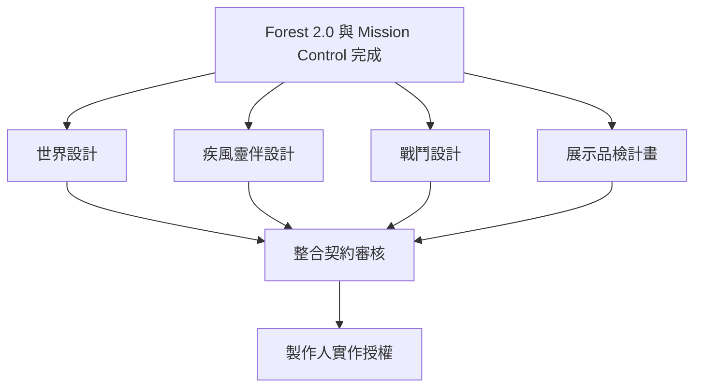

# 7A-5｜三界並行製作與展示計畫

Forest 2.0 以 PR #39 `62e590f665781822ac48bf691e6507f920bf6b68` 為穩定基準，製作人提報 Safari 5／5。PR #40 `1463e675ed1dba4b822b91216984d4c79b38317a` 的任務控制台由製作人提報實機 iPhone Safari 6／6。此里程碑只排規劃與設計，未派工、啟動玩法實作或生成付費素材。

## 7A-1 結案證據

| 段落 | 提報秒數 | 範圍 |
| --- | ---: | --- |
| 基礎工程 | 593 | 核對基準至基礎分支推送 |
| 首次發布審查 | 292 | 第一次發布審查 |
| 修正工程 | 141 | 發布門檻問題重現至推送 |
| 最終發布 | 286 | 最終發布 |
| 合計 | **1,312** | 四段已提報數值相加 |

各段提報的 AI 執行期間人工介入 0 秒。製作人驗收與手動交接時間未知。合計由四筆量測加總，沒有另外登錄為第五筆。Git 證據確認合併提交與來源 head `6c281f7d7ea6dbd4709808f8a5d01ae30d513e2d`，人工、耗時與實機結果來自提報。CI 結果需另核對。

## 3+1 獨立設計工作流

| 優先 | 作業及角色 | 建議分支 | 唯一寫入範圍 |
| ---: | --- | --- | --- |
| 1 | A 森林 3.0 世界設計／Codex | `feat/forest-v3-world-design` | `docs/production/forest-world-design.md` |
| 2 | B 疾風靈伴設計／Codex | `feat/hayate-companion-design` | `docs/production/hayate-companion-design.md` |
| 3 | C 戰鬥 1.0 設計／Codex | `feat/combat-v1-design` | `docs/production/combat-system-design.md` |
| 4 | 展示品檢計畫／Work | `feat/demo-qa-plan` | `docs/production/demo-acceptance-plan.md` |

A 交付有兩條有實質差異的探索路線，標出隱藏瀑布、疾風棲地、寶藏、捷徑、守護者位置、環境敘事和可讀通行帶。B 定義首隻風靈狐疾風（Hayate）的原創造型、待核准的身份參考、四向與動作規格、行為、收集和成長。未取得核准的參考要標註待審。C 定義敵人行為及預警、命中、閃避反擊、風刃、戰鬥回饋、獎勵和進度恢復。品檢工作流先整理實機與畫面驗收，針對迷路、重試和退出另列案例。

**依賴圖**

前三個獨立檔案與品檢檔皆為可排程。所有分支是規劃中的寫入所有權，製作人手動交接後才建立或使用。**只有一個正式整合分支能寫入 ForestScene.ts、共用地圖布局、載入入口或存檔整合。** 各工作流不得同時修改這些檔案。整合契約和實作授權目前為待辦。

## 整合契約與解鎖門檻

1. **世界設計**保有區域、入口、路線與地標 ID。交付座標、腳底原點、可行走區、遮擋、出入口和失敗回程。靈伴和戰鬥使用核准的地標 ID，避免彼此硬編座標。
2. **靈伴**定義遇見、已收集、跟隨、成長與待載入的最小狀態。美術核准與四向幀規格是實作門檻。語音拒絕或失敗可走現有練習備援，不能阻斷收集。與戰鬥的交集先以事件或唯讀狀態表達。
3. **戰鬥**定義預警、活動命中窗、結束、閃避無敵／反擊機會、傷害及獎勵去重。戰鬥擁有命中判定，動畫只讀取事件，依既有移動與足點規格。單次關卡存檔回復與獎勵所有權須共同審閱。
4. **整合審查**先通過 A、B、C 與品檢計畫，再確認事件 payload、ID、失敗回退、存檔版本及共用檔案的唯一維護者。所有共用程式變更須由同一整合分支完成。製作人核准範圍後才開放實作。

## 2026-12-22 展示範圍

目標 10–15 分鐘。先確保遊戲品質，再驗證路線重玩、可重現驗收和實際成本。在已有的村莊／霧竹林能力上做一段完整冒險。

| 預估遊玩 | 內容與出口 |
| --- | --- |
| 2 分鐘 | 從村莊接到線索，少量 HUD 提示帶往森林。 |
| 3 分鐘 | 選主徑或瀑布側徑。主徑先進戰鬥，側徑有環境線索和寶藏，兩路都有回程。 |
| 2 分鐘 | 在疾風棲地遇見靈伴，短句英語練習融入交流，沿用現有語音與協助流程。 |
| 3 分鐘 | 戰鬥與守護者。用一種清楚的攻擊預警、閃避及風刃，允許快速復原。 |
| 2 分鐘 | 獎勵、簡短成長回饋、寶藏及捷徑返回。保留可從另一條路重玩的理由。 |

採原創或已授權音樂與音效，先完成一段探索氛圍、一組戰鬥與互動回饋，沿用行動裝置音訊控制。HUD 重點為生命、目標、互動及獎勵。展示只規劃一隻靈伴、一場守護者戰和一個短英語交流。暫緩多靈伴、多區大型地圖、長劇情及額外學習題庫。遊玩時間為規劃估計，需用實機新存檔計時。

## 製作人交接

開啟控制台「下一步」並複製提示。目前第一項是 **交接森林 3.0 世界設計**。三條工作流各有可複製提示，包含專案、分支、可寫檔案、驗收、交付證據及禁止事項。實際交接後才追加已交接紀錄，取得執行證據後才標成執行中。Work 的獨立品檢流也需手動交接。整合契約、美術身份、支出及實作由製作人授權，發布另依現行規則。[任務登錄](../mission-control/tasks.json)

## 7B-1｜Production Batch 001 收件與交叉審閱

四份固定提交均已從遠端核對並原樣匯入。四件狀態為「已交付、已技術審閱、待製作人批准」，交付狀態與批准分開。A 耗時及人工皆未知。B 226 秒、C 211 秒、QA 174 秒，三件各提報人工 0 秒。已知小計 **611 秒**，沒有足夠資料核對時段重疊或平行速度提升。收件時間是本輪觀察時間，實際開始／完成時間未提報。細部裁決、地圖量測、20 項 QA 複查及下一批隔離範圍依整合契約。唯一優先製作人行動為審閱並核准整合契約。[契約與原稿核對](production/forest-v3-integration-contract.md) · [素材優先順序](production/forest-v3-asset-production-plan.md)
