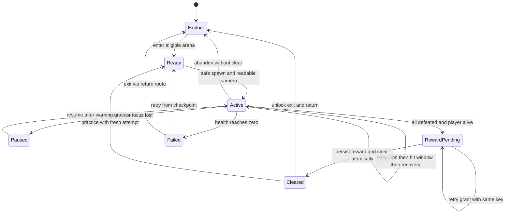

# 三界英語冒險｜戰鬥系統 1.0

Production C／7A-5／AI Development Pipeline 4.0。任務 `combat-v1-design`，分支 `feat/combat-v1-design`。規劃基準為 PR #41 `3c3dcfa1b56970d775973d9bfb4e2de6e2b9e92b`，玩法基準為 Forest 2.0（PR #39）。下列數值是首次調校起點，契約欄位與美術需求待整合審查。[任務登錄](../../mission-control/tasks.json) · [展示計畫](../forest-v3-production-plan.md)

## 2026-12-22 展示

在 10–15 分鐘冒險中，戰鬥與守護者合計約 3 分鐘。主徑先用單隻竹芽教揮劍，再用竹芽與風籽教辨認近、遠預警。側徑用地標與寶藏帶路，可在匯流處補做一次短教學；兩路都可遇見疾風並抵達守護者。一般交戰目標 15–35 秒，守護者 35–60 秒，倒下後三秒內可重試。節奏參考 Brawl Stars 的快速交鋒和 Roblox RIVALS 的短回合與清楚的完成回饋。角色、招式呈現與獎勵皆依霧竹林世界原創。

| 展示必備 | 展示後擴充 |
| --- | --- |
| 兩種普通敵人、一場小守護者、單段劍擊、閃避反擊、風刃與一次可見的疾風援護 | 第三種普通敵人、組合招式、更多守護者、靈伴技能分支 |
| 保證首通獎勵、一個可立即試用的強化、固定重玩配置與練習輔助 | 裝備取捨、熟練度任務、輪替遭遇與可選進階挑戰 |
| 橫向雙指觸控、減少動態、一次情境英語交流 | 更多無障礙配置、語句變體及分級內容 |

## 操作、命中與資源

以 2.5D 視角呈現，地面 XY 與腳底位置決定走位、距離及深度。所有距離以遊戲世界單位表示，時間以本次遭遇的有效遊玩時間計。左拇指沿用搖桿，右側三個獨立按鈕為劍擊、閃避、風刃，觸區至少 48 × 48 CSS px，留至少 8 px 間隔並避開安全區。鍵盤沿用方向鍵／WASD，整合時核對現有劍擊與閃避鍵位，風刃沿用森林 K 鍵入口。即時顯示按下態與冷卻遮罩及圖示。邊移動邊按可用，釋放、取消手勢、失焦及轉向直立時清除觸點及緩衝。直向暫停，恢復時至少留 300 ms 重讀預警，已發生的命中維持原狀。

| 動作 | 展示規格 |
| --- | --- |
| 劍擊 | 按下即給聲畫提示，目標 100 ms 內可感知。前搖 60 ms，活動 90 ms，收招 150 ms。以當下足點為中心、起手鎖定朝向，半徑 55、總角 106°，每個敵人每次揮擊一次，基本 1 傷害。搖桿明確輸入優先，放開時只在正面 ±35°、55 內向最近可見敵人微調，平手依穩定 ID。保留走位。 |
| 閃避 | 沿當下移動方向，零輸入沿正面。沿用 310 單位／秒、160 ms、550 ms 冷卻，開闊處最多約 50 單位，碰牆止於可行走邊界。從起步到 160 ms 結束前免傷。閃避可取消劍擊前搖或收招，活動窗結束後才接受該活動窗內緩衝的閃避。風刃起手也可取消。 |
| 反擊 | 敵方活動窗的首次幾何重疊若被閃避免傷，產生一次 900 ms 反擊機會，綁原攻擊者。下一次劍擊命中該敵人時消耗，造成總計 2 傷害並比一般命中多回 1 靈力。距離外揮空可在剩餘窗口再試。多重機會取首個有效來源，同一敵擊對同一玩家只結算一次。單純走出範圍仍可正常追打。 |
| 風刃 | 2 靈力，成功釋放後冷卻 650 ms。120 ms 起手後釋放，收招 180 ms，前搖可走位、方向於起手鎖定。速度 360、最遠 144、半寬 12，沿地面掃掠，命中第一個敵人即停止並造成 2 傷害，遇硬碰撞即消散。受擊、閃避取消或退出若在釋放前發生，保留靈力。零靈力顯示空格提示，劍擊照常可用。 |

劍擊、風刃各只保存一筆 120 ms 輸入緩衝，閃避可覆蓋這筆輸入。同次取樣優先處理閃避，再處理劍擊、風刃。普通受擊取消未釋放動作，約 100 ms 回饋期間仍可移動與閃避。離開活動窗、換場、死亡或暫停都停止受理會跨狀態生效的緩衝。

戰鬥在每次模擬步先套用合法輸入與碰撞後足點，再以固定時序檢查活動窗。低幀率跨越時間邊界時分段檢查，移動打擊以掃掠避免穿越。劍擊用扇形和敵足點圓交集，敵方命中以同一地面標形與玩家既有 18 × 16 碰撞體相交。劍與風刃遇硬阻擋停止，葉片與遮擋層僅影響呈現。投射物同一步以最早交點結算，交點相同時硬碰撞優先。戰鬥依遭遇、攻擊實例、目標去重。若同一步已有合法命中，先收集再結算，已出手的攻擊可互相命中。玩家倒下時優先走失敗路徑，保留此前完成的進度。

生命沿用 5 顆心，敵人每有效擊扣 1，受擊後 950 ms 保護。扣血保護與閃避免傷重疊時，以閃避成功結算反擊。靈力上限 4，遭遇起始至少 2，成功劍擊每次行動回 1，反擊額外回 1，風刃與疾風援護本身不回靈。遭遇結束及檢查點恢復生命，靈力至少回到 2。HUD 固定顯示心與靈力格，命中火花、短音及填格同步，打空只有劍風。受傷用受擊輪廓、心格更新與低音；成功閃避用空心環變為反擊圖示與清脆音。可關震動與螢幕抖動，減少動態時採靜態描邊、圖示及一致的時間窗。特效不暫停輸入或模擬，無血腥表現。

## 敵人與守護者

| 敵人 | 行為、預警與命中 | 反制 |
| --- | --- | --- |
| 竹芽（3 HP，足點半徑 11） | 接近至 32，鎖定方向，500 ms 橙色扇形漸實並抬身提示，半徑 43、總角 100°；活動 100 ms、收招 750 ms。 | 側移或閃避後貼近反擊。教學場第一擊延長至 700 ms。 |
| 風籽（3 HP，半徑 10） | 試圖維持 80–105 距離，退路被堵即停。600 ms 條帶預警，起手時鎖向，隨後直線風籽投射，速 170、半寬 9、最遠 136、命中一次；結束後至少 850 ms 才可再起手。 | 向側移，或在投射前近身。風刃可從安全位置命中。 |
| 苔木守護者（12 HP，半徑 22） | 只在入口可見的獨立場地交戰。第一階交替使用半徑 72 的 100° 扇掃與長 120、寬 34 的直線震波，第一招固定扇掃。扇掃 800 ms 預警、140 ms 活動，震波 900 ms 預警、120 ms 活動。兩招各有 1,300 ms 露出核心的收招。6 HP 時在當次攻擊結束後以 600 ms 無傷提示進第二階，收招降為 1,000 ms，預警維持。 | 核心露出時可傷害，核心關閉時清楚顯示護殼與擋擊聲，劍擊仍回基本 1 靈力（每次揮擊一次），無反擊加成。正面閃避可接劍，遠距震波後可用風刃，走位後普攻也能通關。 |

普通敵人狀態依序為待命、接近／保持距離、排隊、預警、活動、收招，返回距離判斷。每個小遭遇至多兩敵，共用一個攻擊名額，持有至活動結束（投射物則至命中或消散），下次起手至少隔 250 ms。等待者可側移，身體接觸不扣血且保留出路。預警前受擊可退縮約 120 ms；一旦標形出現，普通命中不移動攻擊來源，死亡可中止尚未出手的攻擊並清除預警。越出可行走區或失去可見路線時不得開始預警。若兩秒無路，退回合法出生點，保留本次 HP。離開遭遇邊界則整場重置，清場前不得領取獎勵。守護者沒有小怪、強制語音或疾風依賴。

普通敵由單隻到近遠組合，守護者以兩種標形和短收招考驗同一套操作。練習輔助可由玩家選擇，預警加 250 ms、反擊窗口加 300 ms，生命與獎勵一致。連續倒下兩次才提示此選項，於重試開始時套用。展示期用固定遭遇及新存檔計時，後續優先調整等待與站位，再調 HP。

## 路線、獎勵與英語

主徑首勝給 1 枚風印，側徑寶藏可提供另一枚風印（寶藏授權由世界與存檔審查決定）。靠近守護者前的安全點，有任一枚即可解鎖並裝備「風紋」，讓風刃最遠距離由 144 變 168，差異可在下一戰觀察。兩路來源各自只發一次；先走另一條路仍能得到其探索回報。守護者首通保證給「苔木徽章」，解鎖安全點的練習重玩，並向世界發出捷徑解鎖條件。重玩以更快完成、成功辨識預警或試用風紋為目標，可重置單場，已取得的首通獎勵留存。未來加入互斥裝備選擇（較遠風刃或較寬劍弧）、技巧里程碑與路線輪替，維持基本敵招的可讀性與固定保底回報。

疾風在安全棲地以 “Follow me.” 配足跡與繁中短譯帶路，沿用現有短句練習。拒絕麥克風或辨識失敗可用文字與點選繼續，收集條件由 B 流定稿。首次敵招可搭配 “Look out!”（小心）及形狀，閃避後可見 “Now!”（趁現在），戰鬥中無答題框或語音判定。安靜模式同時保留圖示和字幕。

疾風已收集且可用時，每場首次進入正式預警可在安全側提示，並給一次「風護」：擋掉下一次原本會扣心的攻擊，三秒有效，僅在成功擋傷時消耗本場配額。若三秒無事發生，下一次新預警可再觸發；一場最多顯示兩次。閃避優先於風護，風護不授予反擊。離場、失敗、換場取消風護。有唯讀收集狀態但畫面載入未就緒時，以護盾圖示與文字呈現同一效果；無法取得有效狀態時照常戰鬥。疾風無碰撞、不吸仇恨，跟隨路線與視覺由 B 流負責。

## 狀態與整合契約

A 流擁有 `regionId`、`landmarkId`、`entryId`、`checkpointId`、`exitId` 與座標。每場由 C 流提供唯一 `encounterId` 及敵編組，綁定 A 流地標與安全腳底點，採同一世界 XY。A 提供多邊形可行走面、硬阻擋與視覺遮擋、鏡頭安全矩形、敵人合法出生點及回程。需於場內容納最長 120 的守護者標形與玩家側移路徑，另驗證出入口至少可容納一個角色碰撞體及兩側緩衝。高竹、神龕淡化與橋岸依原規則，預警或出口被遮住時採描邊提示，失敗回到安全腳底點。A 依已持久化清場狀態開捷徑。實際地標 ID 及位置由 A/C 審查，兩路都須可復原及通關。

事件以 `encounterId, attemptId, seq, atMs` 為共同欄位；`seq` 隨嘗試遞增，`atMs` 是有效遊玩時間，暫停不增長。下表為事件名稱與最少附帶資料，讀取者依當前嘗試與序號忽略過期／重複事件。

| 事件或唯讀資料 | 發布者與欄位 | 消費者與責任 |
| --- | --- | --- |
| `ArenaEntered`／`ArenaExited` | 世界，附入口／出口、地標、檢查點 ID；進場請求由戰鬥核發嘗試 ID | 戰鬥驗證進場資格，退出清空敵人、投射物、緩衝及預警 |
| `AttackTelegraphed`、`HitWindowOpened`、`AttackEnded` | 戰鬥，附 `attackId, sourceId, shape, origin, facing, opensAt, closesAt`；結束附正常或取消原因 | 動畫、地面標形、聲音、疾風提示。移動投射物讀取戰鬥同步位置 |
| `HitResolved`／`CounterOffered` | 戰鬥，附 `attackId, sourceId, targetId, result, hpDelta, spiritDelta`；反擊附來源與截止時間 | HUD、音效、特效。結果含有效、護殼、受傷保護、閃避、風護；消費者不能改血 |
| `CompanionSnapshot`／`AssistApplied` | B 流提供唯讀 `companionId, collected, following, visualReady`；戰鬥讀取並發布 `assistId, expiresAt, outcome` | 疾風與 HUD 視覺更新；戰鬥擁有配額、觸發與結算，重複通知不再施加 |
| `EncounterFailed`／`EncounterCleared` | 戰鬥，附 `checkpointId` 或 `rewardId`、是否首次、存檔確認 | 世界負責返回路線與捷徑，HUD 顯示重試／離開或獎勵；清場事件在存檔確認後發布 |

A 提供安全回程，C 擁有單次嘗試狀態，B 擁有收集及跟隨。正式整合分支的存檔層擁有清場與獎勵持久化，唯一鍵用存檔槽、`encounterId` 與 `rewardId`，同一筆持久操作寫入領取紀錄、獎勵與清場，重入先讀收據以避免跨重整重給。寫入失敗保持可重試的結算畫面與安全退路，重開若無收據可重跑該遭遇，確認過的收據可恢復通關。舊存檔若缺戰鬥欄位採空紀錄與預設配置，保留既有路線及靈伴資料。重試建立新嘗試並回到安全點，完整清除本次敵狀態、投射、援護與冷卻；生命及靈力回到 5／2，裝備、上次完成紀錄與已領獎勵持久化。存檔版本、遊戲中斷與交易方案列入整合門檻。

## 動畫與視覺交付要求

基準的森林入口載入 Movement 1.1 四向 Run／Idle。森林的 `movementReadiness.ts` 與 `runSources.ts` 顯示東跑用 `framesprite`，另有北、西、南 Run 和四向 Idle，Cast 清單只有東、西、南。森林 `EastActions` 中 attack／dash 是呈現計時。村莊 `eikuAnimationConfig.ts` 的正式 96 px 圖集規格與 `eikuSprite.ts` 的備援是另一條路徑，備援 attack 無影格、dodge 借用步行格。正式圖集 README 的 128 格仍列待交付。展示採四向已核准移動與獨立特效；可選 Cast 素材須另核對時間、方向與核准範圍，展示玩法以事件時間為準。[Forest 2.0 升版紀錄](../forest-v2-production-promotion.md) · [森林必要動畫](../../forest-preview/movementReadiness.ts) · [村莊圖集規格](../../art/production/eiku/README.md)

| 項目 | 示範呈現與驗收要求 |
| --- | --- |
| 影空 | 沿用 ForestScene 的足點、Y 深度排序、遮擋、方向倍率、Run／Idle 轉換及牆邊收步。劍弧掛在腳點相對位置且方向跟起手鎖定，閃避用地面風線與輪廓，風刃用短蓄光及四向一致的地面投射輪廓。維持既有 160 ms 閃避位移，特效不帶位移。 |
| 敵人 | 普通敵各需可辨剪影與待命／移動／預警／受擊／退場的簡單呈現。守護者需護殼、抬身、掃擊、核心開合、階段切換及退場。姿勢可由縮放及描邊表達，標形與有效判定同步，至少可透過形狀、圖示與時間填充讀取。 |
| 疾風 | 四向跟隨足點及體型依 B 流審查，風護用圖示或光環。護盾破裂與角色受擊分開，震動屬可選。 |
| 後續動作 | 四向 Attack／Dash 與可用的四向 Cast 須經製作人核准，逐格審核足點、持刀側、起手、命中姿態、恢復與縮小可讀性。播放同步可校準到事件標記，位移、命中與冷卻由戰鬥擁有。 |

## 可重跑驗收與依賴

登錄第一條由敵規格、狀態圖與事件表覆蓋，第二條由操作表、資源回饋及持久化／失敗流程覆蓋。以下為實作後驗收腳本，需記錄起始存檔、遭遇 ID、裝置、時間及結果。設計交付時審讀規格，實機結果待後續品檢。

| 起始條件與操作 | 通過條件 |
| --- | --- |
| 重置普通敵教學場，測四向揮劍、扇形邊界、貼牆、按住方向後攻擊；模擬低幀率 | 每次每敵最多扣一次，牆後不命中，打空無傷害／回靈，移動足點連續。 |
| 竹芽固定起手，選硬邊界旁仍在扇形的腳點，分別於活動開始前 80 ms、200 ms 朝邊界閃避。另在開放處試側移與 900 ms 內追擊 | 首次時序重疊免傷且只給一次反擊，第二次若仍在扇形則扣一心，側移安全且無反擊，成功追擊扣 2 並正確回靈。 |
| 靈力 0／2／4，試風刃、起手取消、穿越近敵與牆、連按 | 0 時空格提示，取消免耗，合法釋放扣 2，第一障礙終止，冷卻期間無重複扣費。 |
| 新存檔各跑主徑與側徑，再以固定初始值跑近遠組及守護者 | 兩路回程可用，預警不重疊發起，守護者有兩種可辨標形；一般 15–35 秒、守護者 35–60 秒作調校目標。 |
| 以 iPhone Safari 橫向雙指操作，轉直／橫、切背景，另用減少動態與靜音重跑 | 操作回饋目標 100 ms 內；無卡住移動或殘留出招；恢復可讀預警；無聲仍可分辨招式、命中、扣心、反擊及風護。 |
| 疾風可用、未收集、畫面載入失敗各跑一場，拒絕麥克風後完成短句備援 | 預警提示與風護各依狀態落地，每場最多擋一次；閃避免傷不消耗援護；可用備援交流並通關。 |
| 守護者戰倒下、同一步互相擊倒、離場，然後重試；結算時模擬寫入失敗，重整並重玩 | 失敗與離場不發獎，三秒內可重試，狀態重置；成功後徽章與捷徑只授予一次，風紋前後的風刃距離差可見，舊存檔可繼續。 |

已完成的前置任務為 Forest 2.0、Mission Control 基礎與製作人手機驗收。A、B 與展示品檢可並行，整合前需共同確認場域尺寸與回程、碰撞及預警圖層、疾風狀態和素材核准、獎勵與存檔所有權，經製作人授權才能實作。共用 ForestScene、載入入口、地圖與存檔由單一整合分支維護。玩家手感、實機顯示效能、180 秒戰鬥分配、場地 ID、疾風與額外圖集仍待核對。
